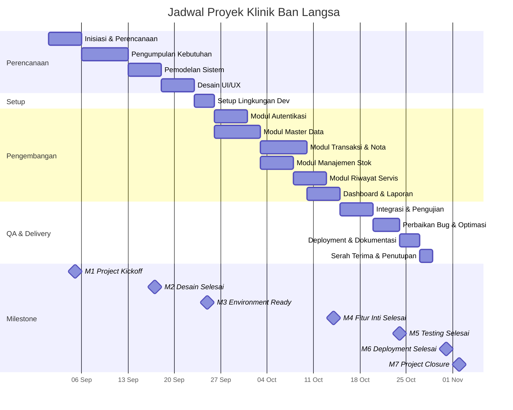

# 📅 Project Schedule — Klinik Ban Langsa

## 1. Daftar Aktivitas (Work Breakdown Structure)

| ID | Fase / Aktivitas | Deskripsi Singkat |
|----|-----------------|-------------------|
| A1 | Inisiasi & Perencanaan Proyek | Penyusunan project charter, identifikasi stakeholder, penentuan scope |
| A2 | Pengumpulan & Analisis Kebutuhan | Wawancara pemilik Klinik Ban Langsa, analisis proses bisnis, pembuatan dokumen SRS |
| A3 | Pemodelan Sistem | Pembuatan Use Case Diagram, ERD, Activity Diagram, dan Sequence Diagram |
| A4 | Desain UI/UX | Wireframe, mockup, dan prototype interaktif |
| A5 | Setup Lingkungan Pengembangan | Konfigurasi repo GitHub, setup Vite + React, Express.js, PostgreSQL, Prisma ORM |
| A6 | Pengembangan Modul Autentikasi | Login multi-role (Admin/Pemilik & Kasir), JWT, bcrypt |
| A7 | Pengembangan Modul Master Data | CRUD Produk (ban luar, ban dalam, oli), CRUD Layanan, CRUD Pelanggan |
| A8 | Pengembangan Modul Transaksi & Nota | Pencatatan penjualan, pemotongan stok otomatis, cetak nota |
| A9 | Pengembangan Modul Manajemen Stok | Monitoring stok, pencatatan stok masuk, peringatan stok menipis |
| A10 | Pengembangan Modul Riwayat Servis | Riwayat servis kendaraan, pengingat jadwal ganti oli |
| A11 | Pengembangan Dashboard & Laporan | Laporan penjualan harian/bulanan, mutasi stok, rekap pendapatan jasa |
| A12 | Integrasi & Pengujian | Integration testing, UAT dengan pemilik Klinik Ban Langsa |
| A13 | Perbaikan Bug & Optimasi | Bug fixing, performance tuning, responsive check |
| A14 | Deployment & Dokumentasi | Deploy ke server/hosting, finalisasi dokumentasi pengguna & teknis |
| A15 | Serah Terima & Penutupan | Demo produk, evaluasi proyek, penyusunan laporan akhir |

---

## 2. Jadwal Proyek (Gantt Chart Textual)

| ID | Aktivitas | Durasi (Hari) | Mulai | Selesai | Dependensi | Milestone |
|----|----------|:-------------:|:-----:|:-------:|:----------:|:---------:|
| A1 | Inisiasi & Perencanaan Proyek | 5 | 01-Sep-2026 | 05-Sep-2026 | — | ✅ M1 |
| A2 | Pengumpulan & Analisis Kebutuhan | 7 | 06-Sep-2026 | 12-Sep-2026 | A1 | |
| A3 | Pemodelan Sistem | 5 | 13-Sep-2026 | 17-Sep-2026 | A2 | ✅ M2 |
| A4 | Desain UI/UX | 5 | 18-Sep-2026 | 22-Sep-2026 | A3 | |
| A5 | Setup Lingkungan Pengembangan | 3 | 23-Sep-2026 | 25-Sep-2026 | A4 | ✅ M3 |
| A6 | Pengembangan Modul Autentikasi | 5 | 26-Sep-2026 | 30-Sep-2026 | A5 | |
| A7 | Pengembangan Modul Master Data | 7 | 01-Okt-2026 | 07-Okt-2026 | A5 | |
| A8 | Pengembangan Modul Transaksi & Nota | 7 | 08-Okt-2026 | 14-Okt-2026 | A6, A7 | ✅ M4 |
| A9 | Pengembangan Modul Manajemen Stok | 5 | 08-Okt-2026 | 12-Okt-2026 | A7 | |
| A10 | Pengembangan Modul Riwayat Servis | 5 | 13-Okt-2026 | 17-Okt-2026 | A9 | |
| A11 | Pengembangan Dashboard & Laporan | 5 | 15-Okt-2026 | 19-Okt-2026 | A8 | |
| A12 | Integrasi & Pengujian | 5 | 20-Okt-2026 | 24-Okt-2026 | A8, A9, A10, A11 | ✅ M5 |
| A13 | Perbaikan Bug & Optimasi | 4 | 25-Okt-2026 | 28-Okt-2026 | A12 | |
| A14 | Deployment & Dokumentasi | 3 | 29-Okt-2026 | 31-Okt-2026 | A13 | ✅ M6 |
| A15 | Serah Terima & Penutupan | 2 | 01-Nov-2026 | 02-Nov-2026 | A14 | ✅ M7 |

**Total Durasi Proyek: ~63 hari kerja (01 September – 02 November 2026)**

---

## 3. Milestone Proyek

| Kode | Milestone | Target Tanggal | Deliverables |
|:----:|----------|:--------------:|-------------|
| M1 | Project Kickoff | 05-Sep-2026 | Project Charter, Stakeholder Register |
| M2 | Desain Selesai | 17-Sep-2026 | SRS, Use Case, ERD, Mockup UI |
| M3 | Environment Ready | 25-Sep-2026 | Repo GitHub, boilerplate frontend & backend |
| M4 | Fitur Inti Selesai | 14-Okt-2026 | Modul Auth, Master Data, Transaksi berfungsi |
| M5 | Testing Selesai | 24-Okt-2026 | Test report, UAT sign-off |
| M6 | Deployment Selesai | 31-Okt-2026 | Aplikasi live, dokumentasi pengguna |
| M7 | Project Closure | 02-Nov-2026 | Laporan akhir, evaluasi proyek, serah terima |

---

## 4. Gantt Chart (Mermaid)

---

## 5. Critical Path

Jalur kritis proyek (aktivitas yang tidak boleh terlambat):

> **A1 → A2 → A3 → A4 → A5 → A7 → A8 → A11 → A12 → A13 → A14 → A15**

Total durasi jalur kritis: **63 hari**. Keterlambatan pada salah satu aktivitas di jalur kritis akan langsung berdampak pada tanggal penyelesaian proyek.

---

